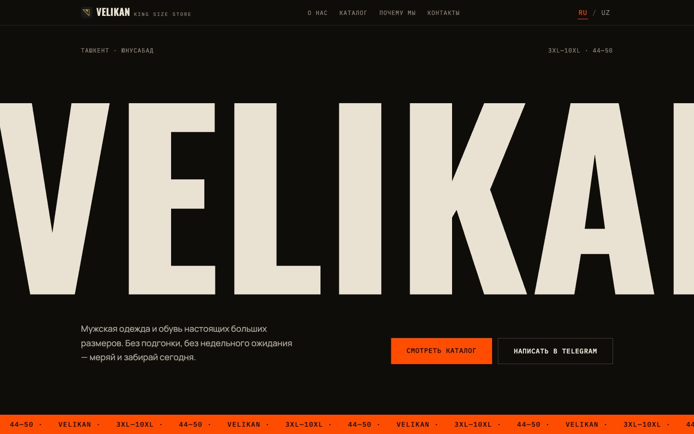
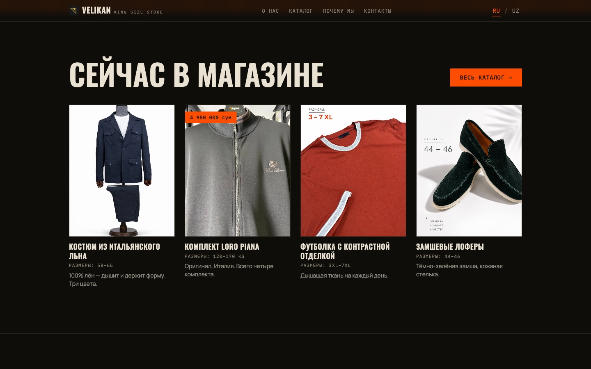
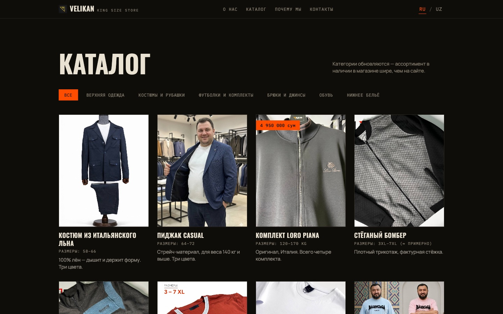
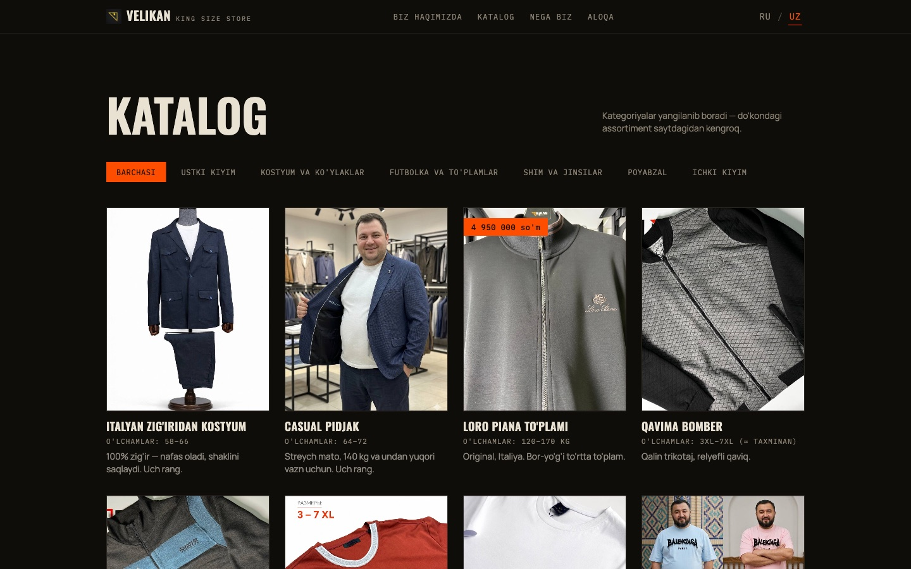
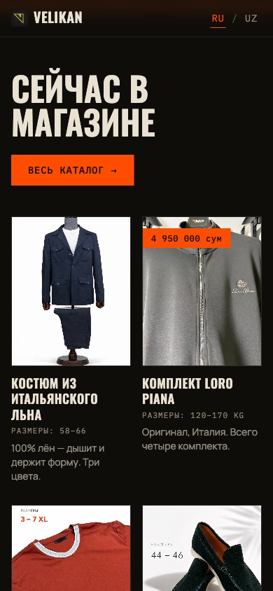

# VELIKAN

Site for VELIKAN, a big & tall menswear shop in Tashkent (Yunusabad, Osiyo 85). They sell clothing up to 10XL and shoes up to size 50, which is genuinely hard to find here, and most of their customers were finding them through Instagram and Telegram with no real site to land on. So: a single-page site with a catalog, built mobile-first because that's where basically all the traffic comes from.

No backend. Product data lives in a TypeScript file and the photos are static assets. The shop updates stock by sending new photos, not by logging into a CMS.



The hero sets the shop name at `34vw` so it overflows the viewport on purpose. "Velikan" means "giant" in Russian, and the whole pitch is that the sizes here don't fit standard racks.

## Running it

```
npm install
npm run dev
```

`npm run build` outputs to `dist/`. It's a static bundle, so any static host works without server config or rewrite rules.

## Stack

Vite, React 18, TypeScript, Tailwind v4, Framer Motion for the layout transitions on the catalog filter and language toggle.

There's no router. The site is two views (landing and full catalog), so `App.tsx` reads `window.location.hash` and swaps between them. Adding React Router for that felt like more moving parts than the problem deserved, and a hash route keeps the build host-agnostic.

## Layout

The landing page opens with the hero, then a four-item "in store now" preview with a button through to the full catalog, then the reasons-to-buy block, store info, and contacts. The full catalog sits behind `#/catalog` with the category tabs.



Catalog filtering is client-side over the `PRODUCTS` array. Categories that don't have photos yet (underwear, currently) fall back to a placeholder tile instead of rendering an empty grid, so adding stock later is just dropping an image in `public/products/` and adding an entry to `src/data/products.ts`.



Sizes come from the shop's own Telegram posts where they were listed. Where they weren't, they're estimated from the garment and marked with a `≈` so nothing reads as a promise.

## Russian and Uzbek

Both languages are real translations, not machine output. The shop's customers are split between them, and the copy has to sound right in each. Russian is the default, and the choice persists in `localStorage`.



It's a plain React context over two typed dictionaries in `src/i18n/`. `Dictionary` is a TypeScript interface, so `tsc` fails the build if one language is missing a key that the other has, which is the main thing that goes wrong with bilingual copy over time. There's no i18n library: with no pluralization or date formatting to handle, there was nothing to install one for.

Product names and descriptions are localized in `src/data/products.ts` alongside the rest of the product data rather than in the dictionaries, since they're per-item content.

## Mobile



Every breakpoint is mobile-up. Worth knowing if you touch the layout: the oversized display type is set in viewport units and clipped deliberately, so it's easy to reintroduce horizontal overflow. Check at 375px before pushing.

## Notes

Fonts are Oswald for display and Manrope for body, with IBM Plex Mono for the small caps labels. Oswald and Plex Mono both ship Cyrillic, which ruled out most condensed display faces (Bebas Neue and Anton have no Cyrillic at all, so the Russian copy would have silently fallen back).

The map is a keyless Google Maps embed with a CSS filter over it to match the dark palette. There are no API keys in this project.

The original single-file HTML prototype was dropped once the React version replaced it; it's still in git history at `98d40d5` under `legacy-prototype/` if it's ever needed.
